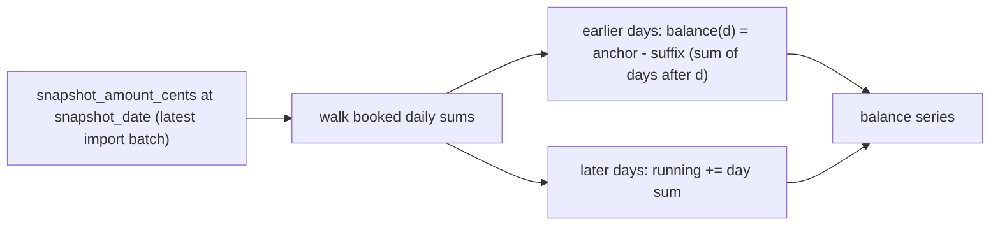

# Analytics

All KPIs, charts, and the transactions table are computed from **one shared
filter pipeline** ([lib/analytics/queries.ts](../lib/analytics/queries.ts)),
with aggregation in SQL (SQLite, via drizzle `sql` fragments) and
month-windowing/balance math in JavaScript
([lib/analytics/engine.ts](../lib/analytics/engine.ts)). The dashboard always
reflects the filtered query results — with one deliberate exception
(balances, see below).

**The planned overlay is deliberately NOT part of this engine.** Planned
(geplante) transactions and the balance projection form a
**third scope** ([ADR-0035](adr/adr-0035-planned-transactions-rrule.md),
[planning.md](planning.md)) with its own endpoint
(`GET /api/plans/forecast`): planned money never enters `computeAnalytics`
results, and real booked money never enters the planned sums (it only moves
the balance line). The dashboard's
"Geplant einblenden" toggle fetches the forecast separately and merges it
into the charts client-side (`mergeBalance`/`mergeCashflow` in
[components/analytics-charts.tsx](../components/analytics-charts.tsx)).

## Filters

`parseFilters()` → `buildWhere()` build the shared WHERE clause from query
params: free text (escaped LIKE over `payee`/`payer`/`purpose`), date range
on `booking_date`, type (`Ausgang`/`Eingang`), category ids (repeated
param), account, label status, and status (`Gebucht` unless `status=all`).
All list values are allow-listed; sort keys are restricted to
`amount_cents / payee / booking_date`. The client serializes the same filter
state into query params ([frontend.md](frontend.md)).

`todayLocal()` ([lib/analytics/date.ts](../lib/analytics/date.ts)) returns
the local-calendar date — deliberately **not** `new Date().toISOString()`,
which would shift month boundaries for non-UTC timezones.

## Monthly cash flow

One grouped SQL query: `month = substr(booking_date, 1, 7)` (the ISO TEXT
format makes this trivial), `income = SUM(CASE WHEN amount_cents > 0 …)`,
`expenses = SUM(-amount_cents WHERE amount_cents < 0)`. JavaScript zero-fills
months between the first and last booking month so the chart has no gaps;
`net = income − expenses` per month.

## Averages and savings rate

Only **full months** count ([ADR-0022](adr/adr-0022-balance-back-calculation.md)
companion rule):

- If data reaches into the current month, the current month is excluded.
- A `dateTo` before the month's last day makes that month partial → excluded.
- A `dateFrom` after the 1st makes the first month partial → excluded.
- `avgIncome = round(sumIncome / monthsCounted)` (same for expenses);
- `savingsRate = (avgIncome − avgExpenses) / avgIncome` — null when
  `avgIncome ≤ 0` or no data; rendered as a percentage.

## Top categories

SQL grouped by `category_id`, **expenses only** (`amount_cents < 0`), ordered
by `SUM(-amount_cents) DESC`, top 12; the share of total expenses is computed
in JS. The `null` category bucket is named "Unlabeled" and colored gray;
every other category gets a stable color from the golden-ratio oklch palette
([frontend.md](frontend.md)).

## Balance timeline (back-calculation)

DKB exports carry a `Kontostand` snapshot at the _end_ of the export period —
not per-transaction running balances. The timeline is therefore
**back-calculated from the anchor** ([ADR-0022](adr/adr-0022-balance-back-calculation.md)):

- Anchor: the latest `snapshot_amount_cents` across all import batches for
  the account.
- Days **before** the snapshot: `balance(d) = anchor − Σ(bookings in
(d, anchorDate])` — the suffix accumulates backward.
- Days **after**: the running sum accumulates forward.
- No snapshot → cumulative sum from zero, flagged `balanceWithoutSnapshot`.
- The `currentBalanceCents` KPI is read from the _unfiltered_ series so an
  empty visible window still yields a value; when `dateTo` precedes all
  data, `balance(dateTo) = anchor − Σ(bookings in (dateTo, anchorDate])`.

**Why balance ignores content filters:** the balance derives from a
_cumulative_ quantity. Filtering to " groceries in March "
would break the suffix math (the anchor includes all transactions) and
produce meaningless "balances". Time scoping (date range, account) is safe
and preserved. This is the single most common source of "why doesn't the
chart match my filter?" questions — the answer is that the chart would be
wrong otherwise.

## Chart integration

The dashboard renders cash flow, categories, and balance via
Recharts inside shadcn `ChartContainer`s; time-series charts get
pinch/wheel-zoom and drag-pan through the custom
[hooks/use-chart-zoom.ts](../hooks/use-chart-zoom.ts) (a `resetKey` resets
the zoom window when the dataset changes). See
[frontend.md](frontend.md) for the client details.

Top spend categories render a visible euro axis with ticks snapped to the
1/2/2.5/5 × 10ⁿ candidates (ceiled to whole euros, never Recharts' arbitrary
adaptive steps). The domain stays pinned to the largest bar total (Ist plus
planned while the overlay is on) so the bars keep their full width, and that
maximum is appended as the final tick (unless its rounded label would repeat
the previous tick), so the longest bar has a label at its end whenever the
rounded value is distinct. A maximum just above a round tick (1.000,50 €)
drops that round tick instead of printing overlapping labels. The number of
ticks follows the measured card width and the width of the formatted euro
labels — narrow or large-value cards get a coarser 1/2/2.5/5 step, and
`interval={0}` renders that pre-thinned ladder instead of Recharts' uneven
subset. A sub-euro maximum degrades to a single zero tick because the labels
print whole euros; if even the origin and max labels cannot fit side by side,
only the origin renders.

While the axis describes Ist money alone (no planned bars share it), each tick
also prints its share of the filtered Ist total on a second line (e.g.
`2.000 €` / `25 %`). The share is a readout, not a 0-100 % scale: the axis
ends on the largest bar total, so the 100 % point is the total spend and is
usually off-chart (it is on-chart only when the largest bar is the whole
total, e.g. a single-category filter). Shares that would round to a false
`0 %` / `100 %` print `<1 %` / `>99 %` instead, on the axis and in the
tooltip. Stacking the lines keeps the label narrow — a single-line `€ · %`
label left too little room for more than a few ticks at the card's width.
Once planned bars share the axis, only euros render:
planned-only rows divide by the 12-month forecast-horizon total while Ist
rows divide by the filtered-period total, so one percentage scale cannot
describe both scopes. An active overlay with no planned expenses leaves the
chart Ist-only and keeps the share line. Tooltips name the basis whenever they
print a share (Ist-period or forecast-horizon, the latter only on planned-only
rows) and print each stacked segment's amount exactly once.

## Correctness

The analytics engine is verified **to the cent** against a generated
24-month fixture with a hand-computed KPI manifest — a second, independent
implementation of the same formulas (see [testing.md](testing.md) and
[ADR-0020](adr/adr-0020-property-tests-money.md) for the testing posture).
